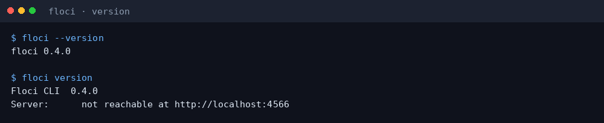
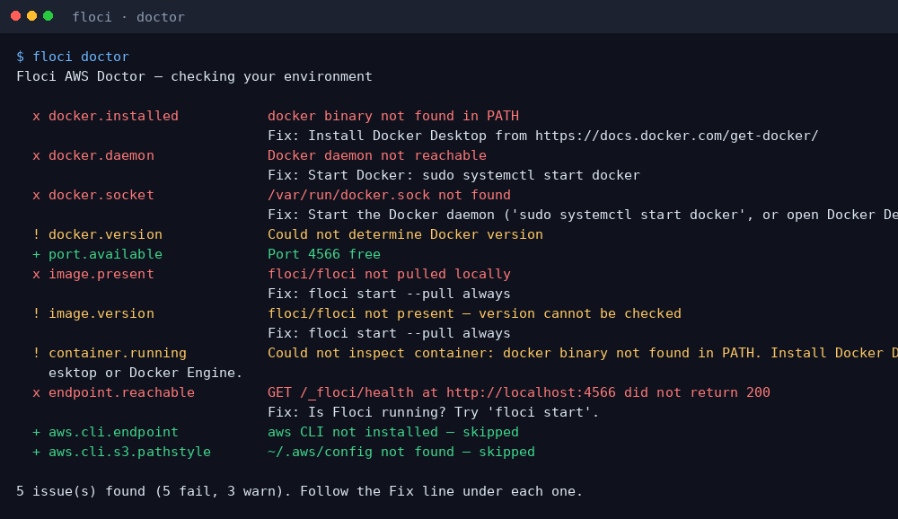
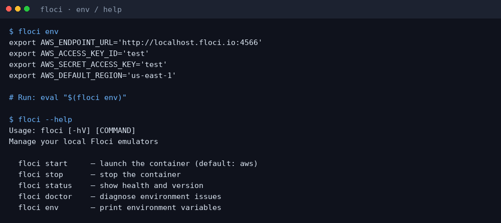
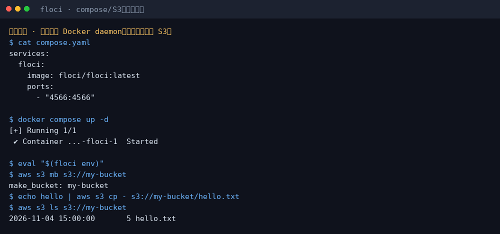

# Floci 小白中文教程

> 免费开源的**本地 AWS 模拟器**（LocalStack Community 替代）：无账号、无 auth token、无功能门控  
> 上游：[`floci-io/floci`](https://github.com/floci-io/floci) · CLI：[`floci-io/floci-cli`](https://github.com/floci-io/floci-cli) · 官网：[floci.io/floci](https://floci.io/floci/)  
> 教程校对：2026-11-04（Asia/Shanghai）· 本机实测 **floci CLI 0.4.0**（linux_amd64）；**无 Docker daemon**，Compose / S3 演示为示意图

[](https://github.com/xianyu110/awesome-floci-zh)
[](https://github.com/floci-io/floci)
[](LICENSE)
[](https://xianyu110.github.io/awesome-floci-zh/)

---

## 截图索引

| # | 文件 | 类型 | 说明 |
|---|------|------|------|
| 1 | [`images/01-install-version.png`](images/01-install-version.png) | **真实** | 官方 release 二进制安装后 `floci --version` / `floci version` → 0.4.0 |
| 2 | [`images/02-doctor.png`](images/02-doctor.png) | **真实** | 无 Docker 时 `floci doctor` 诊断输出 |
| 3 | [`images/03-env-help.png`](images/03-env-help.png) | **真实** | `floci env` 打印假凭证环境变量 + `--help` |
| 4 | [`images/04-compose-s3-schematic.png`](images/04-compose-s3-schematic.png) | **示意图** | `docker compose up` + `aws s3` 冒烟（本环境无 Docker） |

> 截图中的 `AWS_ACCESS_KEY_ID=test` / `AWS_SECRET_ACCESS_KEY=test` 是官方文档允许的**假凭证**，仅用于本地模拟器，不是真实云密钥。

---

## 这是什么？

**Floci** 是免费、开源（MIT）的本地 AWS 模拟器：把 AWS SDK / CLI / Terraform 等指向 `http://localhost:4566`，无需云账号。LocalStack Community 停更后可作为替代（官方称 drop-in）。

官方 CLI **`floci`** 负责拉起/停止 Docker 容器并导出环境变量；也可直接用 Docker Compose，或（文档所述）release 附带的 `floci-aws` 原生二进制（本校对日部分 release 附件列表为空，下载 404，故优先实测 CLI）。

本仓库只提供**中文小白教程**（MIT）。上游 Floci / floci-cli 均为 **MIT**。

---

## 官方链接（请以官方为准）

| 资源 | 链接 |
|------|------|
| 源码（AWS 模拟器） | https://github.com/floci-io/floci |
| CLI 源码 | https://github.com/floci-io/floci-cli |
| 官网 / 文档 | https://floci.io/floci/ |
| Quick Start | https://floci.io/floci/getting-started/quick-start/ |
| 安装（Docker / 原生二进制） | https://floci.io/floci/getting-started/installation/ |
| CLI Releases | https://github.com/floci-io/floci-cli/releases |
| 模拟器 Releases | https://github.com/floci-io/floci/releases |

---

## 环境要求（摘要）

- **Docker 23.0+** + `docker compose` v2（官方推荐；`floci start` 依赖 Docker）
- 或按官方文档使用 **`floci-aws` 原生二进制**（无 Docker 时，不依赖容器的服务仍可用；依赖容器的服务会降级/失败——以官方 installation 页为准）
- 可选：AWS CLI / boto3 / 各语言 AWS SDK（指向本地 endpoint）
- 本教程 Linux x86_64 实测了 **floci CLI 0.4.0** 二进制

---

## 安装（macOS / Windows / Linux）

### 方式 A：官方安装脚本（Linux / macOS）

```bash
curl -fsSL https://floci.io/install.sh | sh
floci --version
```

Homebrew：

```bash
brew install floci-io/floci/floci
```

Windows（PowerShell，官方）：

```powershell
iwr https://floci.io/install.ps1 | iex
```

### 方式 B：直接下载 CLI release 二进制（本教程实测）

从 [floci-cli Releases](https://github.com/floci-io/floci-cli/releases/latest) 取对应平台资源（如 `floci-linux-amd64`），改名并加入 `PATH`：

```bash
curl -fsSL -o floci \
  https://github.com/floci-io/floci-cli/releases/download/0.4.0/floci-linux-amd64
chmod +x floci
./floci --version
# → floci 0.4.0
```



JVM 回退：同 release 的 `floci.jar`，需 **Java 25+**：`java -jar floci.jar version`。

### 方式 C：Docker Compose（无需安装 CLI）

```yaml
# compose.yaml
services:
  floci:
    image: floci/floci:latest
    ports:
      - "4566:4566"
```

```bash
docker compose up -d
```

### 方式 D：原生 `floci-aws` 二进制（可选）

官方 installation 页列出资产名如 `floci-aws-linux-amd64`，安装示例：

```bash
VERSION=x.y.z   # 换成 release 版本号
ASSET=floci-aws-linux-amd64
curl -fsSLO "https://github.com/floci-io/floci/releases/download/$VERSION/$ASSET"
install -m 755 "$ASSET" ~/.local/bin/floci-aws
~/.local/bin/floci-aws
```

> **校对说明（2026-11-04）**：当日查询 `floci-io/floci` 若干 release 的 GitHub assets 列表为空，按文档 URL 直链 `floci-aws-linux-amd64` 返回 404。请以当时 [Releases](https://github.com/floci-io/floci/releases) 实际附件为准；跑不通时改用 CLI + Docker Compose。

---

## 第一次演示任务

### 1）确认 CLI（无需 Docker）

```bash
floci --version
floci doctor
floci env
```

无 Docker 时 `doctor` 会如实报 socket / daemon 缺失——这是预期诊断，不是教程错误。





### 2）启动模拟器（需 Docker）

```bash
floci start
# 或：docker compose up -d
floci wait
eval "$(floci env)"
```

`floci env` 会导出类似：

- `AWS_ENDPOINT_URL=http://localhost.floci.io:4566`（解析到 127.0.0.1）
- `AWS_ACCESS_KEY_ID=test`
- `AWS_SECRET_ACCESS_KEY=test`
- `AWS_DEFAULT_REGION=us-east-1`

### 3）冒烟：S3 / DynamoDB（需模拟器已启动）

官方 Quick Start 示例（摘要）：

```bash
aws s3 mb s3://my-bucket
echo "hello floci" | aws s3 cp - s3://my-bucket/hello.txt
aws s3 ls s3://my-bucket

aws dynamodb create-table \
  --table-name Users \
  --attribute-definitions AttributeName=id,AttributeType=S \
  --key-schema AttributeName=id,KeyType=HASH \
  --billing-mode PAY_PER_REQUEST
```

也可显式加 `--endpoint-url http://localhost:4566`。Web Console：`http://localhost:4566/_floci/ui`（需 Docker socket，见上游 README）。



### 4）停止

```bash
floci stop
# 或 floci stop --remove
```

---

## 常见报错与解决

| 现象 | 可能原因 | 处理 |
|------|----------|------|
| `docker binary not found` / daemon not reachable | 未装或未启动 Docker | 安装 Docker Desktop / Engine 并启动；`floci doctor` 复查 |
| `Server: not reachable at http://localhost:4566` | 模拟器未启动 | `floci start` 或 `docker compose up` |
| `floci-aws-…` 下载 404 | 该版本 release 未附原生二进制 | 改用 CLI + Docker 镜像 `floci/floci:latest` |
| Lambda / RDS 等容器服务失败 | 需要 Docker socket | 给 Compose 挂载 `/var/run/docker.sock`（见官方 README） |
| 旧镜像名 `hectorvent/floci` | 已迁移 | 改为 `floci/floci:latest` |

命令与菜单以 `floci <cmd> --help` 与官方文档为准，本教程不编造子命令。

---

## 许可证与合规

- **本教程文字 / 截图编排**：MIT（见 [`LICENSE`](LICENSE)）
- **上游 Floci / floci-cli**：MIT
- 假凭证 `test`/`test` 仅用于本地模拟；**切勿**把真实 AWS 密钥写进仓库或截图
- 社区非官方导读；与 AWS / LocalStack 无隶属关系

---

## Pages

https://xianyu110.github.io/awesome-floci-zh/
